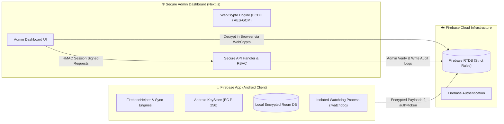

# 🏛️ Dual-Project Master Architecture Vault

> [!IMPORTANT] कड़ा संरचनात्मक विभाजन (Strict Structural Separation)
> यह वॉल्ट आपके दोनों प्रोजेक्ट्स को पूरी तरह अलग-अलग (Separated) रखता है:
> 1. **🌐 [[01 - Secure Admin Dashboard/Architecture_Overview|Secure Admin Dashboard]]** (वेब ब्राउज़र कंसोल, Next.js 14, WebCrypto, RBAC)
> 2. **📱 [[02 - Firebase App/Architecture_Overview|Firebase App]]** (Android बैकग्राउंड क्लाइंट, Room SQLCipher, Keystore, Background Sync)
> 3. **🔗 [[03 - Shared Protocols & RTDB/Realtime_Database_Schema|Shared Protocols & RTDB]]** (Firebase रियल-टाइम डेटाबेस, E2EE हैंडशेक, टोकन सिक्योरिटी)

---

## 🧭 Vault Navigation Map

### 00 - Start Here
- [[01_Obsidian_Kya_Hai_Aur_Fayde|Obsidian क्या है और इसके प्रोजेक्ट व AI के लिए फ़ायदे]]
- [[02_How_To_Open_In_Obsidian|Obsidian में इस वॉल्ट को कैसे खोलें (30 सेकंड गाइड)]]

### 01 - Secure Admin Dashboard (Web)
- [[01 - Secure Admin Dashboard/Architecture_Overview|1. Architecture Overview & Tech Stack]]
- [[01 - Secure Admin Dashboard/Directory_and_File_Map|2. Complete Directory & File Map (A-to-Z)]]
- [[01 - Secure Admin Dashboard/Authentication_and_RBAC|3. Authentication, Multi-Tier RBAC & Progressive Lockout]]
- [[01 - Secure Admin Dashboard/Key_Vault_and_Crypto_Engine|4. Key Vault Context & Client-Side WebCrypto (E2EE)]]
- [[01 - Secure Admin Dashboard/API_Endpoints_Reference|5. Complete API Route & Endpoint Reference]]
- [[01 - Secure Admin Dashboard/Realtime_Sync_and_Firebase|6. Real-time Firebase Sync & Hooks]]
- [[01 - Secure Admin Dashboard/Security_and_DevSecOps|7. Web Security Hardening & DevSecOps Guardrails]]

### 02 - Firebase App (Android Mobile)
- [[02 - Firebase App/Architecture_Overview|1. Mobile Architecture Overview & Lifecycle]]
- [[02 - Firebase App/Directory_and_File_Map|2. Java Package & File Map (A-to-Z)]]
- [[02 - Firebase App/Android_Manifest_and_Permissions|3. Manifest Configuration, Permissions & StrandHogg Mitigation]]
- [[02 - Firebase App/Background_Services_and_Watchdog|4. Notification Listener, Dual-Process Watchdog & Boot Recovery]]
- [[02 - Firebase App/Local_Database_Room_SQLCipher|5. Local Room Database & Data Access Objects (DAOs)]]
- [[02 - Firebase App/Hardware_Keystore_and_Crypto|6. Hardware-Backed Android KeyStore & AES-GCM]]
- [[02 - Firebase App/Sync_Engines_and_Firebase_REST|7. Backup Engines (SMS/Contacts) & Firebase Authenticated REST]]

### 03 - Shared Protocols & RTDB
- [[03 - Shared Protocols & RTDB/Realtime_Database_Schema|1. Unified Firebase Realtime Database Schema]]
- [[03 - Shared Protocols & RTDB/End_to_End_Encryption_Handshake|2. End-to-End Cryptographic Handshake (ECDH + AES-256-GCM)]]
- [[03 - Shared Protocols & RTDB/Threat_Model_and_Security_Rules|3. Threat Model & RTDB Security Rules (`database.rules.json`)]]

### 04 - Cross-System Roadmap
- [[04 - Cross-System Roadmap/Dual_Project_Roadmap_and_Audit|System Status, Audit Verification V4 & Next Milestones]]
