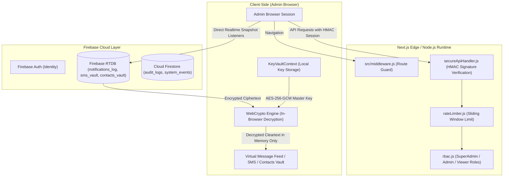

# 🌐 Secure Admin Dashboard — Architecture Overview

> [!NOTE] प्रोजेक्ट पहचान
> - **प्रोजेक्ट नाम:** Secure Admin Dashboard
> - **प्लेटफॉर्म:** Modern Web Browser (Chrome, Firefox, Safari, Edge)
> - **कोडबेस लोकेशन:** `c:\Users\mj\OneDrive\Desktop\SEALTHAPPDASHBOARD`
> - **रिमोट गिट रेपो:** `https://github.com/FARAZSHAH909/StealthDashbaord.git` (शाखा: `staging`)
> - **प्राइमरी स्टैक:** Next.js 14 (App Router), React 18, Tailwind CSS, Firebase Admin/Client SDK, WebCrypto API

---

## 🏗️ कोर आर्किटेक्चरल सिद्धांत (Architectural Principles)

### 1. Zero-Knowledge Client-Side Decryption (शून्य-ज्ञान डिक्रिप्शन)
- सर्वर कभी भी यूज़र के डेटा (कॉल, SMS, कॉन्टैक्ट्स या नोटिफिकेशन्स) को प्लेनटेक्स्ट में नहीं देखता।
- सभी डिक्रिप्शन ब्राउज़र की मेमोरी में **WebCrypto API** द्वारा होती हैं।
- अगर कोई हैकर या अटैकर बैकएंड डेटाबेस को हैक भी कर ले, तो उसे केवल AES-256-GCM एनक्रिप्टेड साइफरटेक्स्ट मिलेगा।

### 2. Multi-Tier Defense-in-Depth (गहन सुरक्षा परतें)
- **परत 1 (Edge Middleware):** `src/middleware.js` हर अनधिकृत रिक्वेस्ट को डैशबोर्ड के मुख्य पेजों तक पहुँचने से पहले ही `/login` पर रीडायरेक्ट कर देता है।
- **परत 2 (HMAC Session Tokens):** केवल कुकी नहीं, बल्कि सर्वर-वेरिफाइड क्रिप्टोग्राफिक HMAC सिग्नेचर (`src/lib/auth/sessionCrypto.js`) चेक होता है।
- **परत 3 (RBAC Enforcement):** सुपर-एडमिन, एडमिन और व्यूअर रोल्स को सख्त अनुमतियों के साथ लागू किया गया है।
- **परत 4 (ग्लोबल रेट लिमिटिंग):** ब्रूट-फ़ोर्स या DoS हमलों को रोकने के लिए प्रोग्रेसिव लॉकआउट और IP रेट लिमिटर मौजूद हैं।

---

## 🔗 संबंधित वॉल्ट नोट्स:
- पूरे फ़ोल्डरों और फ़ाइलों की सूची: [[Directory_and_File_Map|फ़ाइल और डायरेक्टरी मैप]]
- सुरक्षा और टोकन सत्यापन: [[Authentication_and_RBAC|ऑथेंटिकेशन और रोल-बेस्ड एक्सेस कंट्रोल]]
- ब्राउज़र एन्क्रिप्शन इंजन: [[Key_Vault_and_Crypto_Engine|की वॉल्ट और वेबक्रिप्टो]]
- API एंडपॉइंट्स: [[API_Endpoints_Reference|API रूट्स रेफरेंस]]
- मास्टर इंडेक्स: [[00 - Start Here/00_Vault_Index|मास्टर वॉल्ट इंडेक्स]]
