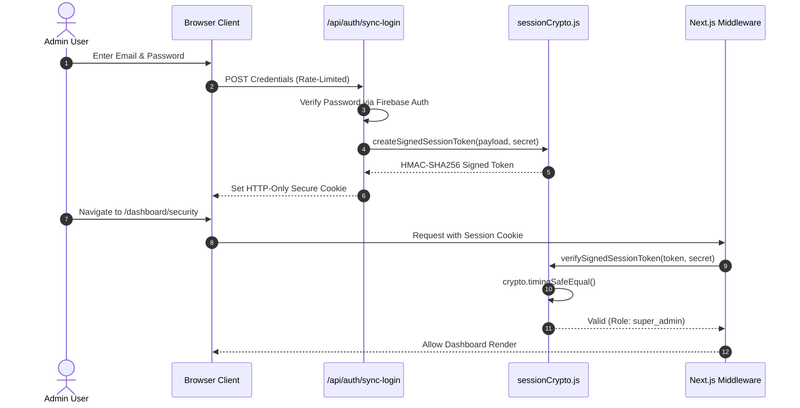

# 🛡️ Secure Admin Dashboard — Authentication & RBAC

This document outlines the authentication pipeline, role-based access control (RBAC), and brute-force defenses for the web dashboard.



---

## 1. Role Hierarchy

Role definitions are managed in `src/lib/auth/rbac.js`:

| Role Name | Access Level | Permissions |
| :--- | :--- | :--- |
| `super_admin` | Level 3 (Highest) | Full dashboard access, admin approvals, role changes, master vault init/rotation, system audit logs. |
| `admin` | Level 2 (Standard) | Device management, token generation, SMS/Notification/Contact viewers, APK release updates. |
| `viewer` | Level 1 (Read-Only) | System metrics and basic device statuses only (no access to decryption keys or sensitive feeds). |

---

## 2. Timing-Safe HMAC-SHA256 Session Verification

In `src/lib/auth/sessionCrypto.js`:
- Every session token is cryptographically signed using an HMAC-SHA256 digest.
- Tokens are verified using Node.js `crypto.timingSafeEqual` instead of string equality operators (`===`).
- This prevents side-channel timing attacks that could reveal token signatures character by character.

```javascript
// Constant-time comparison preventing side-channel attacks
const isSignatureValid = crypto.timingSafeEqual(
    Buffer.from(signature, 'hex'),
    Buffer.from(expectedSignature, 'hex')
);
```

---

## 3. Brute-Force Defense: Progressive Lockout

Handled by `src/app/api/auth/progressive-lockout/route.js`:
1. **1 to 3 Failed Attempts:** Standard error message returned.
2. **4 to 6 Failed Attempts:** Mandatory 30-second delay introduced.
3. **7 to 10 Failed Attempts:** 5-minute strict IP/account lockout.
4. **10+ Failed Attempts:** Account locked, session invalidated, and security incident logged.

---

🔗 Next: [[Key_Vault_and_Crypto_Engine|Key Vault and Crypto Engine]] | [[API_Endpoints_Reference|API Endpoints Reference]]
