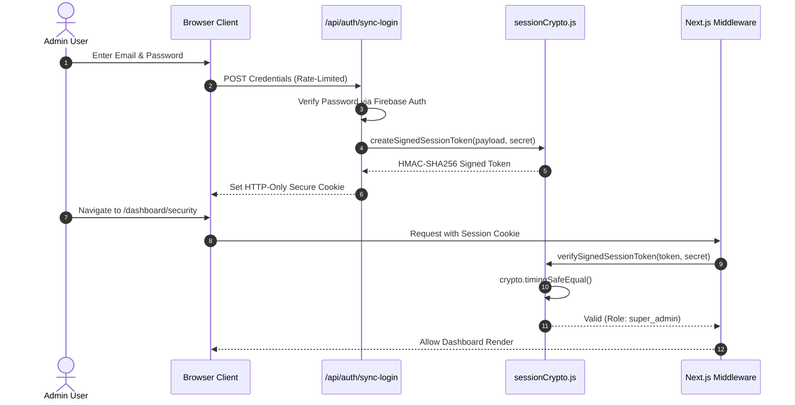

# 🛡️ Secure Admin Dashboard — Authentication & RBAC

यह गाइड वेब डैशबोर्ड की सुरक्षा प्रणाली, ऑथेंटिकेशन फ्लो और रोल-बेस्ड एक्सेस कंट्रोल (RBAC) का तकनीकी विवरण प्रस्तुत करती है।



---

## 1. रोल्स का पदानुक्रम (Role Hierarchy)

`src/lib/auth/rbac.js` द्वारा परिभाषित रोल्स:

| रोल नाम | अनुमति स्तर | अनुमत क्रियाएँ (Permissions) |
| :--- | :--- | :--- |
| `super_admin` | उच्चतम (Level 3) | सभी डैशबोर्ड पेजेस, एडमिन अप्रूवल, रोल्स बदलना, मास्टर वॉल्ट इनिट/रोटेशन, सिस्टम ऑडिट लॉग्स |
| `admin` | मध्यम (Level 2) | डिवाइसेस मैनेजमेंट, डिवाइस टोकन जनरेट करना, SMS/नोटिफिकेशन/कॉन्टैक्ट्स देखना, रिमोट अपडेट जारी करना |
| `viewer` | केवल पठन (Level 1) | केवल एनालिटिक्स और बेसिक डिवाइस स्टेटस देखना (संवेदनशील डेटा या कीज़ तक पहुंच नहीं) |

---

## 2. टाइमिंग-अटैक से सुरक्षित HMAC सेशन टोकन

`src/lib/auth/sessionCrypto.js` में टोकन सत्यापन का तरीका:
- हर टोकन `payload.signature` के रूप में HMAC-SHA256 से साइन होता है।
- टोकन की पुष्टि करते समय स्ट्रिंग्स की तुलना सीधे (`===`) नहीं की जाती (जिससे साइड-चैनल टाइमिंग लीक हो सकती है)।
- इसके बजाय Node.js का `crypto.timingSafeEqual` इस्तेमाल किया जाता है:

```javascript
// Constant-time comparison preventing side-channel attacks
const isSignatureValid = crypto.timingSafeEqual(
    Buffer.from(signature, 'hex'),
    Buffer.from(expectedSignature, 'hex')
);
```

---

## 3. ब्रूट-फ़ोर्स सुरक्षा: प्रोग्रेसिव लॉकआउट (Progressive Lockout)

`src/app/api/auth/progressive-lockout/route.js` लगातार गलत पासवर्ड डालने वाले अटैकर्स को ब्लॉक करता है:
1. **1 से 3 असफल प्रयास:** सामान्य त्रुटि संदेश।
2. **4 से 6 असफल प्रयास:** 30 सेकंड का डिले।
3. **7 से 10 असफल प्रयास:** 5 मिनट का सख्त लॉकआउट।
4. **10+ असफल प्रयास:** एकाउंट फ्रीज और सुपर एडमिन को तत्काल सुरक्षा अलर्ट।

---

🔗 आगे पढ़ें: [[Key_Vault_and_Crypto_Engine|की वॉल्ट और क्रिप्टो]] | [[API_Endpoints_Reference|API रूट्स रेफरेंस]]
