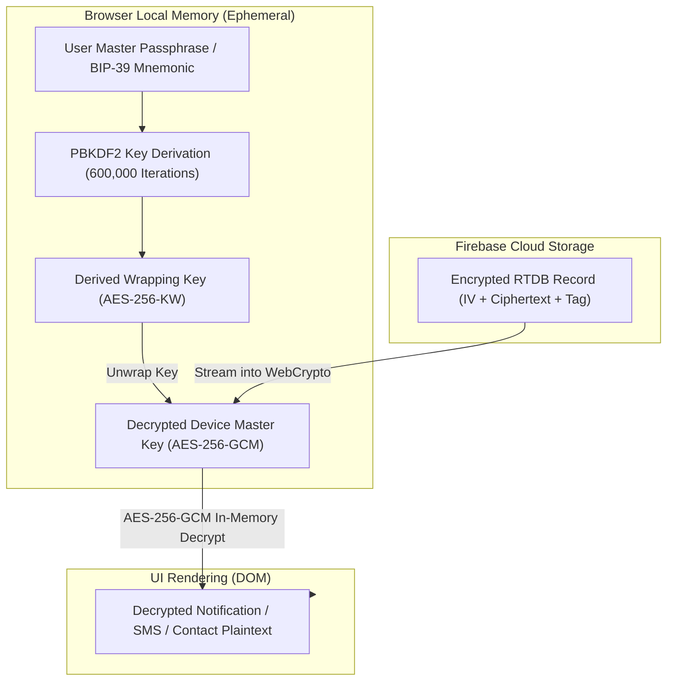

# 🔐 Key Vault & Browser Crypto Engine (E2EE)

यह गाइड वेब डैशबोर्ड में एंड-टू-एंड एन्क्रिप्शन (E2EE) और ब्राउज़र-स्तरीय डिक्रिप्शन इंजन के कार्यप्रणाली को समझाती है।

---

## 1. इन-मेमोरी की वॉल्ट (`KeyVaultContext.jsx`)
- **शून्य लोकल स्टोरेज एक्सपोज़र:** मास्टर डिक्रिप्शन कीज़ को कभी भी ब्राउज़र के `localStorage` या `sessionStorage` में सेव नहीं किया जाता (क्योंकि XSS हमलों में वे चोरी हो सकती हैं)।
- कीज़ केवल रिएक्ट के इन-मेमोरी स्टेट (`useState` / React Context) में रहती हैं।
- ब्राउज़र टैब बंद या रिफ्रेश होते ही मेमोरी अपने आप खाली हो जाती है।

---

## 2. ब्राउज़र-नेटिव WebCrypto API (`webCrypto.js`)
हम किसी थर्ड-पार्टी अनवेरिफाइड जावास्क्रिप्ट लाइब्रेरी का उपयोग करने के बजाय W3C स्टैंडर्ड **WebCrypto API** (`window.crypto.subtle`) का इस्तेमाल करते हैं:

- **AES-256-GCM:** 256-बिट की लंबाई, 96-बिट इनिशियलाइजेशन वेक्टर (IV), और 128-बिट ऑथेंटिकेशन टैग के साथ एन्क्रिप्शन और डिक्रिप्शन।
- **ECDH (Elliptic Curve Diffie-Hellman):** P-256 कर्व के साथ डिवाइस और सर्वर के बीच की-एक्सचेंज।
- **PBKDF2-HMAC-SHA256:** पासवर्ड से की तैयार करने के लिए 600,000 राउंड्स।

---

## 3. BIP-39 रिकवरी पाथ (`bip39.js`)
- यदि एडमिन अपना पासवर्ड भूल जाता है, तो 12 या 24 शब्दों का BIP-39 स्मरणीय बीज (Mnemonic Seed) मास्टर की को रीकवर करने के लिए उपयोग किया जा सकता है।

---

🔗 आगे पढ़ें: [[Realtime_Sync_and_Firebase|रियल-टाइम सिंक और हुक्स]] | [[03 - Shared Protocols & RTDB/End_to_End_Encryption_Handshake|E2EE हैंडशेक]]
