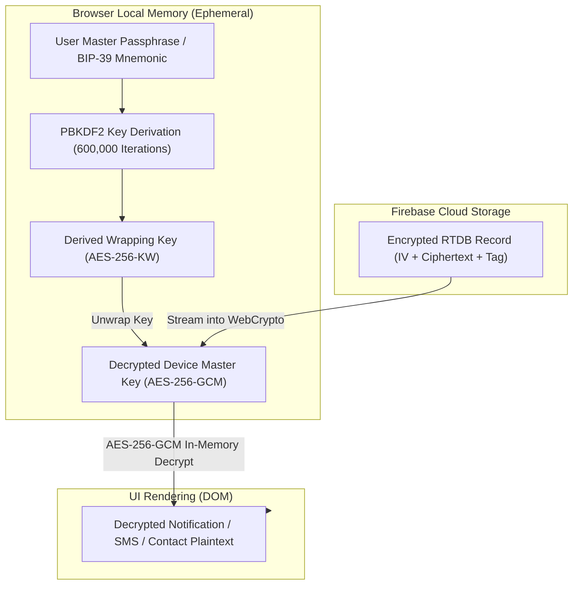

# 🔐 Key Vault & Browser Crypto Engine (E2EE)

This guide explains how end-to-end encryption (E2EE) and browser-side decryption work inside the Secure Admin Dashboard.

---

## 1. Volatile In-Memory Key Storage (`KeyVaultContext.jsx`)
- **Zero LocalStorage Exposure:** Master keys are never written to `localStorage`, `sessionStorage`, or IndexedDB where cross-site scripting (XSS) could steal them.
- Keys are kept exclusively within React memory state (`useState` / Context).
- Closing or refreshing the browser tab immediately wipes all decryption keys from memory.

---

## 2. Browser-Native WebCrypto API (`webCrypto.js`)
Instead of bundling untrusted third-party cryptography libraries, the dashboard utilizes the standard **W3C WebCrypto API** (`window.crypto.subtle`):

- **AES-256-GCM:** 256-bit symmetric encryption with a 96-bit unique IV and 128-bit authentication tag.
- **ECDH (Elliptic Curve Diffie-Hellman):** NIST P-256 curve key agreement between mobile devices and the web console.
- **PBKDF2-HMAC-SHA256:** 600,000 iterations to derive high-entropy keys from passphrases.

---

## 3. BIP-39 Mnemonic Recovery (`bip39.js`)
- If an admin loses their password, the 12 or 24-word BIP-39 mnemonic seed phrase provides deterministic recovery of the master wrapping key.

---

🔗 Next: [[Realtime_Sync_and_Firebase|Realtime Sync & Custom Hooks]] | [[03 - Shared Protocols & RTDB/End_to_End_Encryption_Handshake|E2EE Handshake]]
