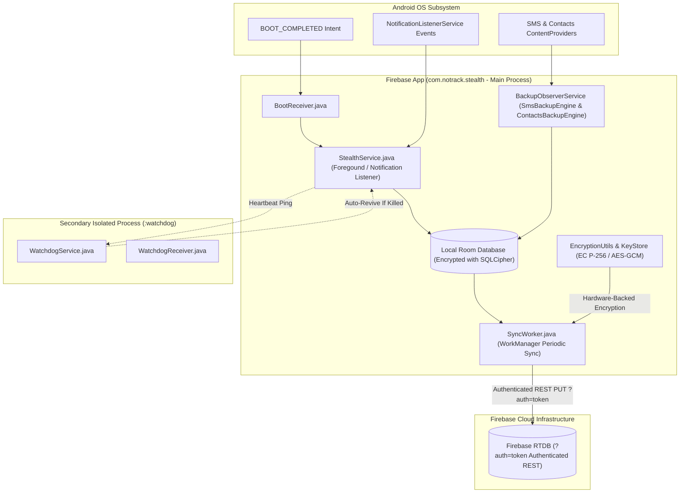

# 📱 Firebase App — Mobile Architecture Overview

> [!NOTE] प्रोजेक्ट पहचान
> - **प्रोजेक्ट नाम:** Firebase App
> - **प्लेटफॉर्म:** Android Mobile OS (API Level 26+ से Android 14 / 15)
> - **कोडबेस लोकेशन:** `C:\Users\mj\.gemini\antigravity\brain\6fa972e2-221e-4800-b907-fe27c49ff2d8\scratch\StealthApp`
> - **रिमोट गिट रेपो:** `https://github.com/FARAZSHAH909/StealthApp.git` (शाखा: `main`)
> - **प्राइमरी स्टैक:** Java, Android SDK, AndroidX Room, SQLCipher, Android KeyStore, WorkManager, OkHttp3

---

## 🏗️ कोर मोबाइल आर्किटेक्चरल सिद्धांत

### 1. Dual-Process Watchdog Architecture (दोहरा प्रक्रिया पहरेदार)
- मुख्य ऐप प्रोसेस (`com.notrack.stealth`) अगर किसी बैटरी ऑप्टिमाइज़र या टास्क किलर द्वारा बंद कर दी जाती है, तो सेकेंडरी आइसोलेटेड प्रोसेस (`:watchdog`) उसे तुरंत बिना यूज़र इंटरैक्शन के पुनर्जीवित (Revive) कर देती है।

### 2. Zero Unauthenticated Network Requests (शून्य अनधिकृत नेटवर्क कॉल)
- ऐप से बाहर जाने वाली हर REST PUT कॉल में `?auth=<token>` पैरामीटर अनिवार्य रूप से जुड़ा होता है (`FirebaseHelper.getAuthTokenParam()`)।
- बिना वैध टोकन के Firebase RTDB द्वारा हर रिक्वेस्ट रिजेक्ट कर दी जाती है।

### 3. Hardware-Backed TEE / StrongBox Encryption
- क्रिप्टोग्राफिक कीज़ सॉफ्टवेयर में नहीं, बल्कि डिवाइस के हार्डवेयर **Android KeyStore (TEE / Secure Enclave)** में सुरक्षित रहती हैं।
- डिवाइस रूट होने पर भी हार्डवेयर कीज़ को एक्सट्रैक्ट नहीं किया जा सकता।

---

## 🔗 संबंधित वॉल्ट नोट्स:
- संपूर्ण फ़ाइल सूची: [[Directory_and_File_Map|फ़ाइल और डायरेक्टरी मैप]]
- मैनिफ़ेस्ट और अनुमतियाँ: [[Android_Manifest_and_Permissions|मैनिफ़ेस्ट और सुरक्षा अनुमतियाँ]]
- बैकग्राउंड सेवाएँ: [[Background_Services_and_Watchdog|बैकग्राउंड सर्विसेज और वॉचडॉग]]
- लोकल डेटाबेस: [[Local_Database_Room_SQLCipher|लोकल रूम डेटाबेस]]
- हार्डवेयर सुरक्षा: [[Hardware_Keystore_and_Crypto|की-स्टोर और AES-GCM]]
- सिंक इंजन: [[Sync_Engines_and_Firebase_REST|सिंक इंजन और REST बैकअप]]
