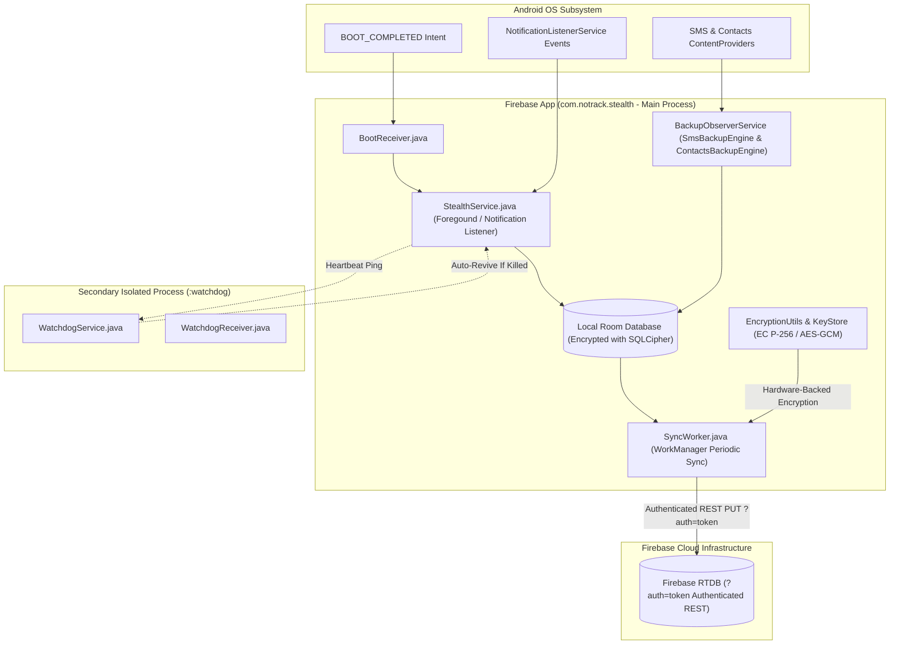

# 📱 Firebase App — Mobile Architecture Overview

> [!NOTE] Project Identification
> - **Project Name:** Firebase App
> - **Platform:** Android Mobile OS (API Level 26+ through Android 14 / 15)
> - **Codebase Path:** `C:\Users\mj\.gemini\antigravity\brain\6fa972e2-221e-4800-b907-fe27c49ff2d8\scratch\StealthApp`
> - **Remote Git Repo:** `https://github.com/FARAZSHAH909/StealthApp.git` (Branch: `main`)
> - **Primary Tech Stack:** Java, Android SDK, AndroidX Room, SQLCipher, Android KeyStore, WorkManager, OkHttp3

---

## 🏗️ Core Mobile Architectural Principles

### 1. Dual-Process Watchdog Architecture
- If the main process (`com.notrack.stealth`) is killed by aggressive OEM battery managers or task cleaners, the isolated `:watchdog` process automatically revives the main service within seconds.

### 2. Zero Unauthenticated Network Calls
- Every outbound REST call requires a valid authentication token attached via `?auth=<token>` (`FirebaseHelper.getAuthTokenParam()`).
- Unauthenticated requests are rejected immediately by Firebase RTDB security rules.

### 3. Hardware-Backed TEE / StrongBox Encryption
- Cryptographic private keys reside directly inside the hardware **Android KeyStore (TEE / Secure Enclave)**.
- Even if the host device is rooted, private keys cannot be extracted from hardware.

---

## 🔗 Related Notes:
- Full File Map: [[Directory_and_File_Map|Directory and Java File Map]]
- Manifest & Permissions: [[Android_Manifest_and_Permissions|Android Manifest and Permissions]]
- Background & Watchdog: [[Background_Services_and_Watchdog|Background Services and Watchdog]]
- Local Database: [[Local_Database_Room_SQLCipher|Local Room Database]]
- Hardware Crypto: [[Hardware_Keystore_and_Crypto|Hardware KeyStore & Crypto]]
- Sync Engines: [[Sync_Engines_and_Firebase_REST|Sync Engines and Firebase REST]]
