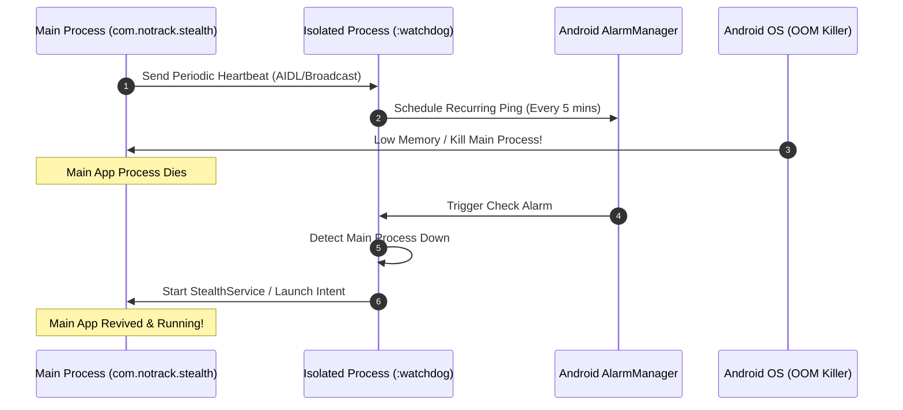

# ⚙️ Background Services & Dual-Process Watchdog

How the mobile app stays running 24/7 despite aggressive Android OS battery managers, Doze Mode, and OOM killers.

---

## 1. `StealthService.java` (Notification Listener & Core Service)
- Extends Android's `NotificationListenerService`.
- **System Privileges:** Bound with `android.permission.BIND_NOTIFICATION_LISTENER_SERVICE`, which grants high OS priority and immunity to standard background killing.
- Whenever a notification arrives (WhatsApp, Telegram, Gmail, SMS, etc.), `onNotificationPosted` fires instantly.
- The raw notification text is immediately encrypted with AES-256-GCM and stored in the local Room database.

---

## 2. `:watchdog` Isolated Process (`WatchdogService.java`)
- Runs in a separate process: `android:process=":watchdog"`.
- Operates under its own distinct Linux PID in the Android process table.
- If a user or cleaner app force-stops or clears the main app, the watchdog process survives and re-launches the main services automatically within seconds.

---

## 3. Boot Recovery (`BootReceiver.java`)
- Listens for `ACTION_BOOT_COMPLETED` and `ACTION_LOCKED_BOOT_COMPLETED`.
- Restarts all background workers immediately upon device boot, even before the user unlocks the lockscreen (Direct Boot support).

---

🔗 Next: [[Local_Database_Room_SQLCipher|Local Room Database]] | [[Sync_Engines_and_Firebase_REST|Sync Engines]]
