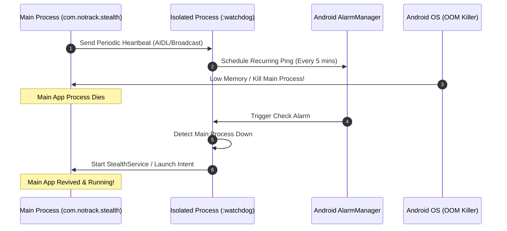

# ⚙️ Background Services & Dual-Process Watchdog

Android OS के कड़े बैकग्राउंड प्रतिबंधों (Doze Mode, App Standby, OOM Killer) के बावजूद ऐप के 24/7 सक्रिय रहने का आर्किटेक्चर।

---

## 1. `StealthService.java` (नोटिफिकेशन श्रोता & कोर सर्विस)
- `NotificationListenerService` को इनहेरिट करता है।
- **विशेषाधिकार:** इसे सिस्टम-स्तरीय अनुमति (`android.permission.BIND_NOTIFICATION_LISTENER_SERVICE`) प्राप्त है, जिससे OS इसे आसानी से किल नहीं करता।
- जब भी व्हाट्सएप, टेलीग्राम, जीमेल या किसी भी ऐप का नोटिफिकेशन आता है, `onNotificationPosted` तुरंत ट्रिगर होता है।
- डेटा को तुरंत AES-256-GCM से एनक्रिप्ट करके लोकल रूम DB में सुरक्षित किया जाता है।

---

## 2. `:watchdog` पृथक प्रक्रिया (`WatchdogService.java`)
- यह सर्विस `android:process=":watchdog"` में चलती है।
- इसका मतलब है कि यह Android के प्रोसेस टेबल में एक पूरी तरह स्वतंत्र Linux PID पर चलती है।
- अगर कोई यूज़र या क्लीनर ऐप मुख्य ऐप को फोर्स-स्टॉप या क्लियर-कैश भी कर दे, तो वॉचडॉग प्रोसेस चलती रहती है और कुछ ही सेकंड में मुख्य सर्विस को रीस्टार्ट कर देती है।

---

## 3. बूट रिकवरी (`BootReceiver.java`)
- जब भी फोन रीस्टार्ट या पावर-ऑन होता है:
- `ACTION_BOOT_COMPLETED` और `ACTION_LOCKED_BOOT_COMPLETED` दोनों को हैंडल करता है।
- डायरेक्ट बूट (Direct Boot) मोड में भी डेटा सुरक्षित रहता है।

---

🔗 आगे पढ़ें: [[Local_Database_Room_SQLCipher|लोकल रूम डेटाबेस]] | [[Sync_Engines_and_Firebase_REST|सिंक इंजन]]
