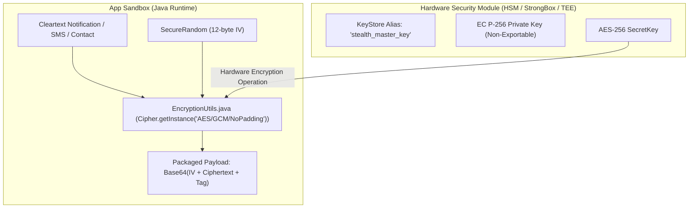

# 🔐 Hardware-Backed Android KeyStore & Cryptography

Firebase App संवेदनशील एन्क्रिप्शन कीज़ को सुरक्षित रखने के लिए Android KeyStore सिस्टम का उपयोग करती है।

---

## 1. हार्डवेयर सुरक्षा (`KeyEnrollmentHelper.java`)
- **कर्व P-256 (secp256r1):** डिवाइस पहली बार शुरू होने पर एलिप्टिक कर्व की-पेयर जनरेट करता है।
- **Non-Exportable:** प्राइवेट की कभी भी TEE चिप से बाहर नहीं निकाली जा सकती। एन्क्रिप्शन और साइनिंग ऑपरेशन्स चिप के भीतर ही होते हैं।
- **StrongBox Keymaster:** यदि डिवाइस हार्डवेयर StrongBox (अलग सुरक्षा चिप) का समर्थन करता है, तो कीज़ को StrongBox में आइसोलेट किया जाता है।

---

## 2. AES-256-GCM सिमेट्रिक एन्क्रिप्शन (`EncryptionUtils.java`)
- **एल्गोरिदम:** `AES/GCM/NoPadding`
- **की लंबाई:** 256 बिट्स।
- **IV (इनिशियलाइजेशन वेक्टर):** प्रत्येक मैसेज के लिए 12-बाइट का क्रिप्टोग्राफ़िकली सुरक्षित रैंडम IV जनरेट होता है। कभी भी IV को दोबारा इस्तेमाल (Reuse) नहीं किया जाता।
- **ऑथेंटिकेशन टैग:** 128-बिट GCM टैग सुनिश्चित करता है कि डेटा में किसी ने रत्ती भर भी छेड़छाड़ नहीं की है।

---

🔗 आगे पढ़ें: [[Sync_Engines_and_Firebase_REST|सिंक इंजन और Firebase REST]] | [[03 - Shared Protocols & RTDB/End_to_End_Encryption_Handshake|E2EE हैंडशेक]]
