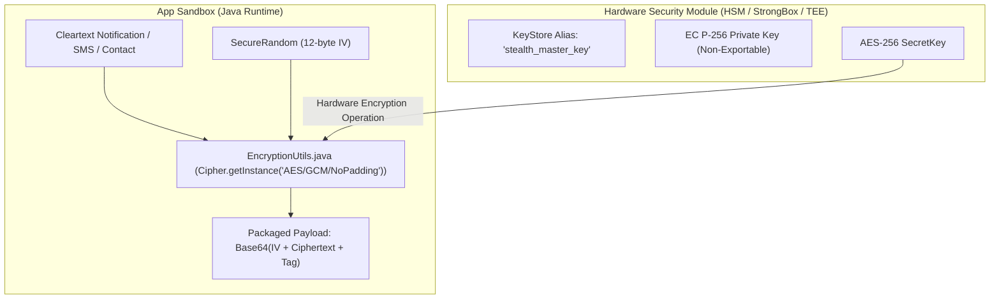

# 🔐 Hardware-Backed Android KeyStore & Cryptography

The Firebase App secures all encryption keys inside the Android hardware-backed KeyStore system (Trusted Execution Environment / StrongBox).

---

## 1. Hardware Isolation (`KeyEnrollmentHelper.java`)
- **NIST P-256 Curve (secp256r1):** The app generates an elliptic curve key pair on first launch inside the KeyStore.
- **Non-Exportable Keys:** Private keys can never be extracted from the secure hardware chip. Cryptographic signing and decryption happen inside the chip itself.
- **StrongBox Support:** Devices with dedicated hardware security chips store keys in StrongBox for maximum tamper resistance.

---

## 2. AES-256-GCM Symmetric Encryption (`EncryptionUtils.java`)
- **Algorithm:** `AES/GCM/NoPadding`.
- **Key Length:** 256 bits.
- **Initialization Vector (IV):** A unique, cryptographically random 12-byte IV is generated for every single record via `SecureRandom`.
- **Authentication Tag:** A 128-bit authentication tag guarantees message integrity and prevents tampering.

---

🔗 Next: [[Sync_Engines_and_Firebase_REST|Sync Engines and Firebase REST]] | [[03 - Shared Protocols & RTDB/End_to_End_Encryption_Handshake|E2EE Handshake]]
