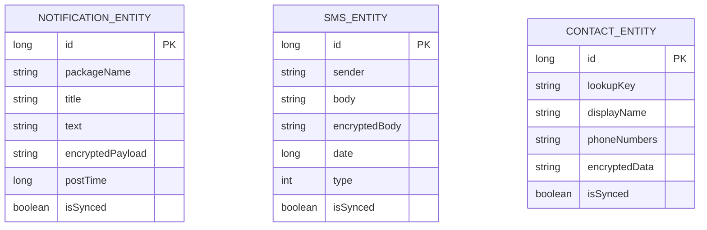

# 🗄️ Local Encrypted Database — Room & SQLCipher

Android डिवाइस पर ऑफलाइन स्टोरेज और डेटा सुरक्षा के लिए SQLite डेटाबेस को 256-बिट AES एन्क्रिप्शन (**SQLCipher**) से लॉक किया गया है।

---

## 1. SQLCipher रेस्ट-एन्क्रिप्शन (Encryption at Rest)
`AppDatabase.java` में:
- साधारण SQLite फाइल के विपरीत, डेटाबेस फाइल डिस्क पर बाइट-लेवल पर एन्क्रिप्टेड रहती है।
- यदि डिवाइस को कंप्यूटर से कनेक्ट करके ADB या रूट एक्सप्लोरर से `.db` फाइल निकाल भी ली जाए, तो वह बिना हार्डवेयर की के खोली नहीं जा सकती।

---

## 2. डेटा एंटिटी और टेबल स्कीमा

### `NotificationEntity.java`
- `packageName`: नोटिफिकेशन भेजने वाली ऐप की पहचान (उदा. `com.whatsapp`)।
- `encryptedPayload`: AES-256-GCM द्वारा सुरक्षित टेक्स्ट, शीर्षक और टाइमस्टैम्प।
- `isSynced`: बूलियन फ्लैग (0 = केवल लोकल, 1 = Firebase पर अपलोडेड)।

### `SmsEntity.java`
- `sender`: फोन नंबर या सेंडर ID।
- `encryptedBody`: मैसेज की सुरक्षित सामग्री।
- `date`: मैसेज आने/जाने का यूनिक्स टाइमस्टैम्प।
- `type`: 1 (इनबॉक्स), 2 (सेंट)।

### `ContactEntity.java`
- `displayName`: संपर्क का नाम।
- `phoneNumbers`: मोबाइल/होम/वर्क नंबर (JSON ऐरे)।
- `encryptedData`: पूरा एनक्रिप्टेड संपर्क रिकॉर्ड।

---

🔗 आगे पढ़ें: [[Hardware_Keystore_and_Crypto|हार्डवेयर की-स्टोर और क्रिप्टो]] | [[Sync_Engines_and_Firebase_REST|सिंक इंजन]]
