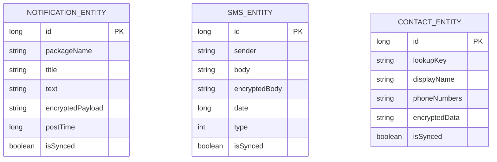

# 🗄️ Local Encrypted Database — Room & SQLCipher

For offline storage and defense against physical extraction attacks, the Android client protects all local SQLite data using 256-bit AES **SQLCipher** encryption at rest.

---

## 1. SQLCipher Encryption at Rest
In `AppDatabase.java`:
- Unlike standard unencrypted SQLite databases, every byte written to disk is encrypted on-the-fly.
- Even if an attacker connects the device to ADB or roots the phone to extract the `.db` file, it cannot be read without the hardware-backed key.

---

## 2. Entity Schemas & Tables

### `NotificationEntity.java`
- `packageName`: Identifies the sending application (e.g., `com.whatsapp`).
- `encryptedPayload`: AES-256-GCM ciphertext containing notification title, body, and timestamp.
- `isSynced`: Boolean flag (0 = local only, 1 = successfully synced to Firebase RTDB).

### `SmsEntity.java`
- `sender`: Telephone number or sender ID.
- `encryptedBody`: E2EE encrypted message body.
- `date`: Epoch millisecond timestamp.
- `type`: 1 (Inbox) or 2 (Sent).

### `ContactEntity.java`
- `displayName`: Contact name.
- `phoneNumbers`: JSON array of phone numbers.
- `encryptedData`: Full contact payload encrypted with AES-256-GCM.

---

🔗 Next: [[Hardware_Keystore_and_Crypto|Hardware KeyStore & Crypto]] | [[Sync_Engines_and_Firebase_REST|Sync Engines]]
