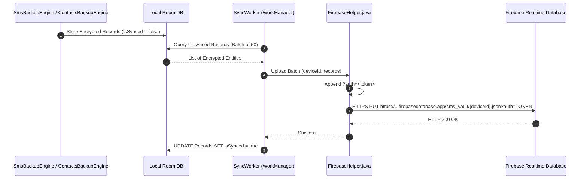

# 🔄 Backup Engines & Authenticated Firebase REST

How the Android client captures, encrypts, and synchronizes data to Firebase Realtime Database over authenticated REST endpoints.



---

## 1. Token-Enforced REST Security (`FirebaseHelper.java`)
Under the V4 security hardening updates, all unauthenticated REST requests were permanently closed.
- `FirebaseHelper.java` automatically appends `?auth=<token>` to every outbound HTTP call:

```java
// Strictly enforce token parameter on all REST requests
String url = FIREBASE_DB_URL + "/" + node + "/" + deviceId + ".json" + getAuthTokenParam();
Request request = new Request.Builder()
    .url(url)
    .put(RequestBody.create(jsonPayload, JSON))
    .build();
```

---

## 2. Dedicated Backup Engines

### `SmsBackupEngine.java`
- Monitors telephony providers (`content://sms`) for incoming and outgoing SMS.
- Activated in real-time by `BackupObserverService`.
- Encrypts SMS content in memory before committing it to the local SQLite database.

### `ContactsBackupEngine.java`
- Scans `ContactsContract.CommonDataKinds.Phone`.
- Deduplicates and cleans phone numbers.
- Pushes encrypted contact snapshots whenever a contact is added or updated.

---

🔗 Next: [[03 - Shared Protocols & RTDB/Realtime_Database_Schema|RTDB Schema]] | [[03 - Shared Protocols & RTDB/Threat_Model_and_Security_Rules|Threat Model & Rules]]
