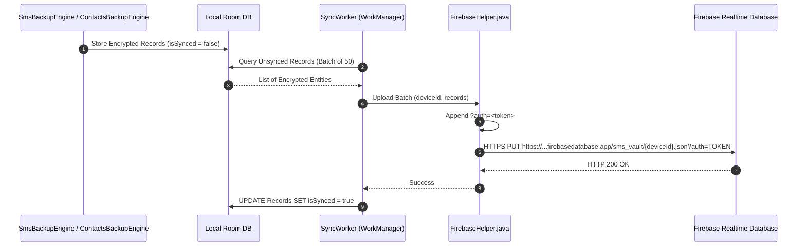

# 🔄 Backup Engines & Authenticated Firebase REST

यह गाइड Android ऐप से Firebase Realtime Database में डेटा ट्रांसफर और बैकअप प्रक्रिया को समझाती है।



---

## 1. टोकन प्रमाणीकरण (`FirebaseHelper.java`)
V4 सुरक्षा सुधार के अनुसार, सभी अनधिकृत REST कॉल्स को बंद कर दिया गया है। 
- `FirebaseHelper.java` में `getAuthTokenParam()` विधि हर नेटवर्क कॉल में ऑथेंटिकेशन टोकन जोड़ती है:

```java
// Strictly enforce token parameter on all REST requests
String url = FIREBASE_DB_URL + "/" + node + "/" + deviceId + ".json" + getAuthTokenParam();
Request request = new Request.Builder()
    .url(url)
    .put(RequestBody.create(jsonPayload, JSON))
    .build();
```

---

## 2. बैकअप इंजनों की कार्यप्रणाली

### `SmsBackupEngine.java`
- टेलीफ़ोनी प्रोवाइडर (`content://sms`) से इनबॉक्स और आउटबॉक्स को मॉनिटर करता है।
- `BackupObserverService` द्वारा वास्तविक समय में नए SMS को डिटेक्ट करता है।
- संवेदनशील मैसेज बॉडी को तुरंत TEE की से एनक्रिप्ट करता है।

### `ContactsBackupEngine.java`
- `ContactsContract.CommonDataKinds.Phone` प्रोवाइडर को स्कैन करता है।
- डुप्लिकेट फोन नंबर्स को क्लीन और नॉर्मलाइज करता है।
- डिवाइस में नया कॉन्टैक्ट ऐड होते ही बैकग्राउंड में सिंक ट्रिगर करता है।

---

🔗 आगे पढ़ें: [[03 - Shared Protocols & RTDB/Realtime_Database_Schema|RTDB स्कीमा]] | [[03 - Shared Protocols & RTDB/Threat_Model_and_Security_Rules|डेटाबेस सुरक्षा नियम]]
