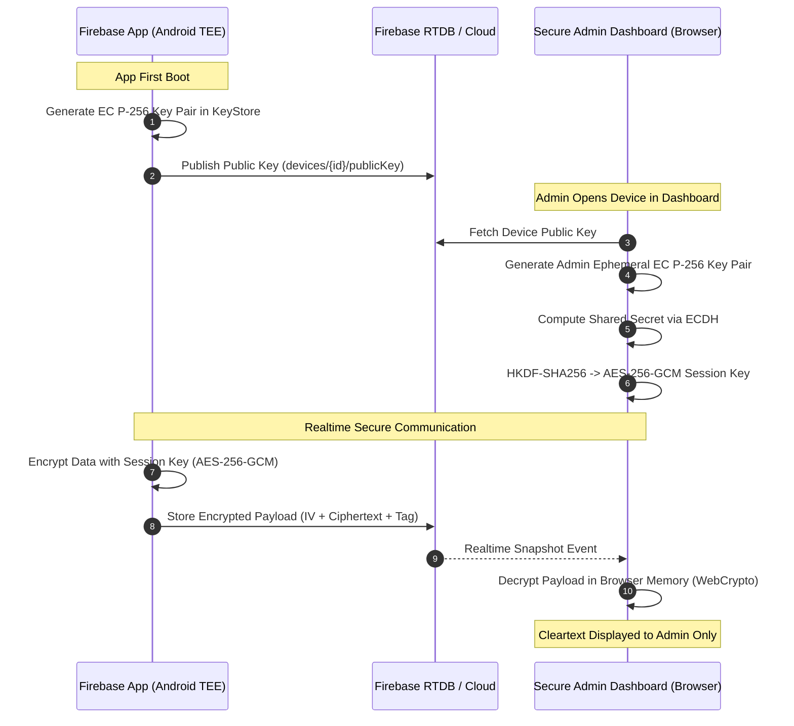

# 🤝 End-to-End Cryptographic Handshake Protocol

The cryptographic key agreement between the [[02 - Firebase App/Architecture_Overview|Firebase App]] (Android Client) and the [[01 - Secure Admin Dashboard/Architecture_Overview|Secure Admin Dashboard]] (Web Browser).

---

## 1. Cryptographic Specifications

| Component | Standard / Algorithm | Implementation Target |
| :--- | :--- | :--- |
| **Elliptic Curve** | NIST P-256 (secp256r1) | Android KeyStore & Browser WebCrypto |
| **Key Agreement** | ECDH (Elliptic Curve Diffie-Hellman) | Both Clients |
| **Key Derivation (KDF)** | HKDF-SHA256 (RFC 5869) | `signatureUtils.js` |
| **Symmetric Cipher** | AES-256-GCM (12-byte IV, 128-bit Tag) | `EncryptionUtils.java` & `webCrypto.js` |
| **Mnemonic Recovery** | BIP-39 (12/24 Word Seed) | `bip39.js` |

---

## 2. Zero-Trust Security Guarantees
1. **The Cloud Never Sees Plaintext:** Firebase RTDB and Google servers store only ciphertext blobs.
2. **Forward Secrecy:** Ephemeral key agreement ensures past sessions cannot be decrypted if a session key is compromised.
3. **Hardware Root of Trust:** Even on rooted phones, private keys cannot be extracted from the Android KeyStore TEE.

---

🔗 Next: [[Threat_Model_and_Security_Rules|Threat Model & Security Rules]] | [[04 - Cross-System Roadmap/Dual_Project_Roadmap_and_Audit|Roadmap & Audit Status]]
