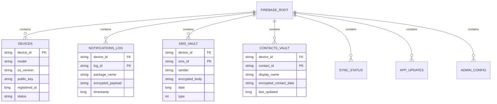

# 🗄️ Unified Firebase Realtime Database Schema

The shared data architecture connecting the [[01 - Secure Admin Dashboard/Architecture_Overview|Secure Admin Dashboard]] and the [[02 - Firebase App/Architecture_Overview|Firebase App]].



---

## 1. Node Structure & Access Matrix

### `/devices/{deviceId}`
- **Permissions:** Device writes its own status; Admins read and write.
- **Payload:** Device model, Android OS version, EC P-256 public key, battery percentage, and last seen heartbeat timestamp.

### `/notifications_log/{deviceId}/{notificationId}`
- **Permissions:** Device writes its own records only; Admin reads.
- **Sample Record:**
  ```json
  {
    "package": "com.google.android.talk",
    "timestamp": 1795243444005,
    "payload": "IV:Ciphertext:Tag (AES-256-GCM)"
  }
  ```

### `/sms_vault/{deviceId}/{smsId}`
- **Permissions:** Device writes its own records only; Admin reads.
- **Payload:** Encrypted SMS body, sender identity, timestamp, and message direction.

### `/contacts_vault/{deviceId}/{contactId}`
- **Permissions:** Device writes its own records only; Admin reads.
- **Payload:** Encrypted address book entry and phone numbers.

### `/app_updates/`
- **Permissions:** Super Admin writes only; All devices read.
- **Sample Payload:**
  ```json
  {
    "versionCode": 4,
    "versionName": "1.0.4",
    "apkUrl": "https://storage.googleapis.com/.../app-release.apk",
    "sha256": "e3b0c44298fc1c149afbf4c8996fb92427ae41e4649b934ca495991b7852b855",
    "mandatory": true
  }
  ```

---

🔗 Next: [[End_to_End_Encryption_Handshake|E2EE Handshake]] | [[Threat_Model_and_Security_Rules|Threat Model & Rules]]
